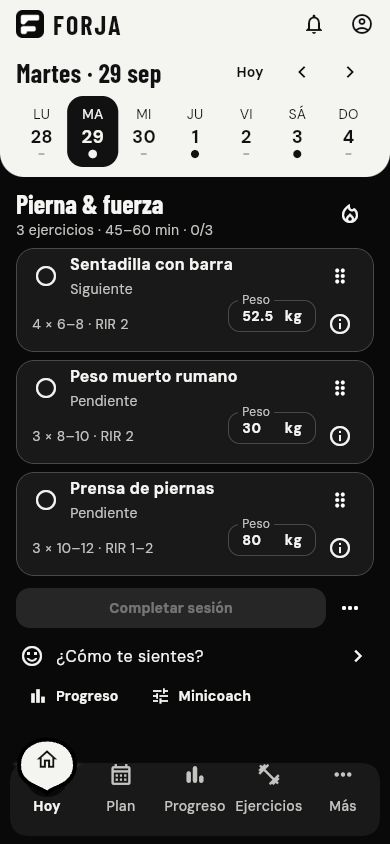

# Validación de la entrega · 30 de septiembre de 2026

## Comprobado

- SDK: Flutter 3.47.5, Dart 3.13.4.
- `flutter analyze --no-pub`: sin incidencias.
- `flutter test --no-pub`: 16 pruebas aprobadas.
- `flutter build web --no-pub`: compilación terminada correctamente.
- Vista previa web revisada a 390 × 844: tres ejercicios y botón de finalizar visibles, sin quedar detrás de la navbar.
- Todas las pantallas probadas a 320 px con texto al 200%, sin errores de desbordamiento.
- Completar/desmarcar, peso, menú por toque, drag y flechas de teclado verificados.
- Panel de detalles y check-in con cierre visible; devolución del foco comprobada.
- Acción de completar invocada desde semántica de lector de pantalla; área de peso de al menos 44 px comprobada.
- Contraste de los pares de texto de la paleta comprobado. Títulos y selectores revisados visualmente y corregidos en el tema global.
- Perfil y peso editado restaurados al recargar la vista previa; prueba del repositorio comprueba el resto de los registros tras recrearlo.
- Fallos de escritura, escrituras concurrentes, reprogramación y versión incompatible comprobados.



## Verificación nativa pendiente

Se intentó `flutter build apk --debug` con el SDK de Android instalado. La compilación se detuvo en `url_launcher_android:compileDebugJavaWithJavac` con `java.nio.file.AccessDeniedException` al acceder/cerrar `core-ktx-1.2.0-api.jar` en la caché de Gradle de este entorno Windows. También se probaron JDK 25 y JDK 21. **No se generó ni se confirmó una APK instalable.** (Actualización P0 al final del documento: en la máquina actual la compilación debug sí terminó; la instalación en dispositivo sigue pendiente.)

El proyecto utiliza AGP 9 y Kotlin integrado, con `android.builtInKotlin=true`, de acuerdo con las dependencias nativas actuales y Flutter 3.47+. [Documentación de Flutter](https://docs.flutter.dev/release/breaking-changes/migrate-to-built-in-kotlin/for-app-developers).

Verificar de nuevo en un entorno con acceso normal a su caché de Gradle:

```sh
flutter pub get
flutter build apk --debug
flutter run
```

La compilación y ejecución iOS no se comprobaron en este ordenador Windows. El proyecto incluye los archivos nativos, pero su firma, compilación y prueba en un dispositivo deben completarse con Xcode en macOS.

## Alcance de estas comprobaciones

Las pruebas y la compilación web validan el código Dart y las interacciones del MVP; no sustituyen las pruebas de los plugins en Android/iOS. Las notificaciones nativas, sincronización, progresión avanzada y demás funciones indicadas en `ALCANCE.md` siguen pendientes de integración.

## Paquete documental 1.0 · 2026-09-30

Se creó el SDD y la documentación/skills para completar las funciones. No se modificó código funcional ni se repitieron analyze/tests/builds de la app en esta unidad.

Comprobación ejecutada con Python sobre archivos guardados:

- 20 Markdown operativos y 35 enlaces locales, sin destinos faltantes.
- 15 secciones únicas F00–F14, presentes en la matriz de estado.
- Siete skills con nombre de carpeta/frontmatter coherentes y formato de dos campos válido, sin plantillas sin terminar.
- 23 recursos originales de las cuatro skills preservados idénticos por SHA256.

El validador quick_validate.py de skill-creator no pudo ejecutarse por falta de PyYAML (ModuleNotFoundError). Se usó una comprobación local del formato restringido de los entrypoints (name/description simples), nombres, enlaces y archivos; no se instaló esa dependencia ni se validaron los scripts originales archivados.

Las limitaciones de ui-ux-pro-max (data/scripts apuntan a rutas ausentes) están en el catálogo de skills. Los scripts originales son referencias conservadas, no herramientas declaradas funcionales.

## Línea base P0 · 2026-09-30

Ejecutada desde la raíz actual del proyecto en Windows 10 Pro 22H2 (x64), SDK Android 36.0.0, JAVA_HOME con Temurin JDK 21.0.12.1. Sin cambios de código.

| Comando | Resultado |
| --- | --- |
| `flutter --version` | Flutter 3.47.5 stable, Dart 3.13.4 (SDK fuera del PATH; doctor lo advierte) |
| `flutter pub get` | Correcto; lockfile sin cambios (5 paquetes con versiones nuevas fuera de constraints, no se actualizaron) |
| `dart format --output=none --set-exit-if-changed lib test` | 40 archivos, 0 cambios |
| `flutter analyze` | Sin incidencias (20.3 s) |
| `flutter test` | 16/16 aprobadas |
| `flutter build apk --debug` | Correcto en 778.5 s; `build/app/outputs/flutter-apk/app-debug.apk`, 155.5 MB, 2026-09-30 15:19:53 |

- El fallo histórico de `AccessDeniedException` en la caché de Gradle **no se reprodujo** en esta máquina; la APK debug quedó confirmada.
- `android/local.properties` apunta al SDK de esta máquina y está excluido por `android/.gitignore` (verificado con `git check-ignore -v`); no se versionan rutas.
- La ejecución de Flutter requirió una excepción local `safe.directory` por entorno (el SDK pertenece a otro usuario) aplicada solo por invocación, sin modificar la configuración global de Git.

### Pendiente / bloqueado (P0)

- **Instalación y smoke en dispositivo (pendiente):** se lanzó el emulador Pixel 9a disponible; adb lo mantuvo `offline` más de 18 minutos con qemu casi inactivo (posible falta de aceleración/virtualización en este entorno). Se cerró el emulador. No hay dispositivo Android físico conectado. La APK no se instaló ni ejecutó. (Reintento en P1: ver abajo.)
- **iOS (pendiente):** sin macOS/Xcode no se compila ni firma.
- **Doctor:** Android toolchain marca cmdline-tools ausente y estado de licencias desconocido; ninguno bloqueó el build debug. Visual Studio ausente (no relevante para móvil).
- **Git:** repositorio inicializado en la raíz, rama `master` sin commits y todo sin trackear. El usuario decidió el 2026-10-01 no hacer commits.

## P1 · F00 SQLite/Drift · 2026-10-01

Windows 10 Pro 22H2 (x64), Flutter 3.47.5 / Dart 3.13.4, JDK 21. Sin commit (decisión del usuario; rama `master` sin commits). Paquetes resueltos: drift 2.35.1, drift_dev 2.35.1, drift_flutter 0.3.1, sqlite3 3.5.2 (SQLite 3.53.4 empaquetado por build hooks), path_provider 2.1.6, build_runner 2.16.1.

| Comando | Resultado |
| --- | --- |
| `dart format --output=none --set-exit-if-changed lib test` | 0 cambios |
| `flutter analyze` | Sin incidencias |
| `flutter test` | **107/107** aprobadas (≈20 s): 8 UI previas, 11 repositorio sobre SQLite real, 9 diff, 35 decoder, 14 importación, 12 almacén, 17 arranque, 1 esquema |
| `flutter test --coverage` | 107/107. Líneas: decoder, importer, diff, source, storage_failure, startup VM/vista y forja_app 100 %; drift_forja_store 98.8 %; repositorio 98.7 %; local_store_opener 93.3 %; app_dependencies 80.6 % (sin cubrir: ruta de apertura real con `LocalStoreOpener` y rama de error de `initialize`) |
| `dart run build_runner build` / `drift_dev make-migrations` / `schema generate` | Correcto; volcado v1 en `drift_schemas/forja/` |
| `flutter build apk --debug` | Correcto (primera vez 331.7 s con descarga de SDK Platform 35 y CMake 3.22.1; repetida 30 s). APK 186.5 MiB con `libsqlite3.so` y `libdartjni.so` en arm64-v8a, armeabi-v7a y x86_64 |

Criterios F00 y su evidencia (host): snapshot v1 completo → DB sin pérdida y comparado contra el JSON original (`legacy_import_test`); reinicio restaura todo (`repository_test`, `drift_store_test`); doble importación sin duplicados (segundo arranque y dos importaciones simultáneas); fallo/IO y disco lleno (`PRAGMA max_page_count`) no comunican éxito y hacen rollback, incluido un fallo a mitad de reprogramación y un fallo en el `COMMIT`; concurrencia de peso/checklist/orden/check-in sin pérdida; secuencia aleatoria semillada de 320 comandos idéntica a memoria a través de reinicios, con `integrity_check` y `foreign_key_check` limpios; base de versión futura rechazada sin cambios; esquema contra volcado versionado.

**Las pruebas detectan errores** (mutaciones temporales, revertidas y comprobadas): sin transacción en `commit` fallan 2 pruebas; ignorar overrides `null` falla 2; ordenar alimentos por id falla la secuencia aleatoria (paso 55); añadir una columna sin versionar falla la prueba de esquema. Una primera versión de esa prueba pasaba con la tabla mutada (comparaba el volcado consigo mismo) y se sustituyó por `validateDatabaseSchema()`.

Hallazgos corregidos: `tearDown` de `testWidgets` no puede esperar `dispose()` asíncrono (cuelga) → `unawaited`; `fl` es alias de `Format-List` en PowerShell (scripts de apoyo fuera del repo); `pub add` vía `.bat` pierde el `^` de las versiones (corregido a mano en pubspec).

### Prueba de actualización en dispositivo real (2026-10-01)

Redmi/Xiaomi `2412DPC0AG` (rodin_global), Android 16 (SDK 36), arm64-v8a, 1220×2712, depuración USB. Hubo que habilitar "Instalar vía USB" (primer intento: `INSTALL_FAILED_USER_RESTRICTED`). FORJA no estaba instalada, así que no había datos reales.

1. `adb install` de la APK **0.1** (copia previa a P1): arranca; se crearon datos con la 0.1 (perfil peso 82 / energía Alta, "Press de banca" a 67.5 kg y completado). Existía `files/datastore/FlutterSharedPreferences.preferences_pb`.
2. `adb install -r` de la APK **nueva** (sin desinstalar; `firstInstallTime` conservado): arranca sin errores en logcat, sin onboarding, y Hoy muestra los mismos datos. Aparece `files/forja.sqlite`; el perfil abierto desde la app muestra 82 kg, Alta y "Última revisión: 1 oct".
3. Escritura nueva (completar "Press de hombro") + `force-stop` + reapertura: persiste (2/3).
4. Base extraída del teléfono e inspeccionada con un test temporal (eliminado): `user_version` 1, marcador `forja_flutter_snapshot_v1` en `imported` (1 sesión, 0 overrides/check-ins/alimentos), perfil 82.0 kg / `high` / `onboarded`, sesión con origen `legacySnapshotV1` y `created_at` desconocido, ejercicios con 67.5 kg completado (importado) y el nuevo completado, `integrity_check: ok`.

Cubre en Android real: ruta de producción (`driftDatabase` en isolate de fondo, `getApplicationSupportDirectory`), lectura del backend DataStore de la 0.1, importación única y persistencia tras cierre forzado. **No cubre:** datos extensos (solo 1 sesión), actualización con check-ins/alimentos/reprogramaciones reales, notificaciones, ni iOS. La app de depuración (con esos datos de prueba) sigue instalada en el teléfono.

## Racha de entrenos (F15) · 2026-10-02

Pedida por el usuario: «un sistema de racha con iconos de flama naranja animada como Duolingo y con un calendario mensual y anual». Decisiones del usuario (D36): cuenta los entrenos del plan; modo flexible (parciales cuentan, reprogramar salva); llama en la barra superior; vista anual como mapa de calor.

- **Implementado:** `lib/domain/services/streak_rules.dart` (reglas `streak-v1`, puras, sin cambio de esquema), `lib/ui/streak/` (`StreakViewModel`, `StreakFlame` dibujada con dos capas naranja/amarilla y parpadeo finito, `StreakBadge` en la barra superior, `StreakPage` con calendario mensual, mapa de calor anual y tabla por mes), colores `flame`/`flameCore`/`flameDeep`/`flameOff` en el tema, nombres completos de meses en `date_utils`.
- **Pruebas nuevas (`test/streak_test.dart`, 23):** reglas con fechas fijas (sin sesiones, descansos, falta y mejor racha, parcial/actividad/día abierto sin nada, reprogramado y deshecho, hoy y futuro, antes de empezar, conteo por mes); disposición del mapa (1 o 2 bloques); contraste del naranja (≥ 3:1 sobre papel, superficie y fondo); en la app: insignia con el número y su etiqueta para lector, entrenar hoy enciende la llama y suma, la página abre mes/año/tabla con navegación, semántica por día («Sábado 12 sep: faltaste»), mes desde lunes y año de semanas completas, animación que termina y movimiento reducido, cuatro tamaños sin desbordes y con dos columnas cuando caben, guías de objetivo/etiqueta/contraste. **Hallazgo corregido por las pruebas:** cada día del calendario no era un nodo propio para el lector de pantalla (se fundía con la tarjeta). Mutaciones: sin parciales (fallan 2), sin neutralidad de reprogramadas (falla 1).
- **Teléfono (release instalado, 2026-10-02):** llama gris con «0» junto a la campana y página de racha con calendario de octubre. Hallazgos corregidos: (1) una sesión guardada el 1 oct sin nada hecho (estado «Programada», 0/3, probablemente por editar un peso) iniciaba el conteo y salía como falta: ahora el conteo empieza en el primer entreno o la primera falta marcada (prueba nueva; la regla anterior la hace fallar); (2) con racha 0 en descanso decía «tu racha sigue»: ahora «Tu racha empieza con tu próximo entreno». Versión corregida instalada y comprobada en el teléfono: el 1 oct se anuncia «Jueves 1 oct: sin registro», el mes muestra «0 entrenos · 0 faltas» y el mensaje nuevo aparece en la página y en la etiqueta de la llama de la barra superior.
- **Host (Windows, Flutter 3.47.5):** format sin cambios, `flutter analyze` sin incidencias, `flutter test` **712/712**. Capturas con `tool/capture_screens_test.dart` (ahora siembra ocho semanas e incluye la página de racha) revisadas a 390×844 y 1024×768.
- **Pendiente:** las reglas son una heurística de motivación (revisar con una persona antes de publicar, como `prog-v1`).

## Barra de navegación: reparto de los elementos · 2026-10-02

Pedido por el usuario: «mejora la navbar, haz que se acomoden mejor los elementos». También pidió desactivar TalkBack: en el teléfono ya estaba desactivado (`enabled_accessibility_services` nulo, `accessibility_enabled=0`, `touch_exploration_enabled=0`, ningún servicio ligado); no hubo que cambiar nada.

- **Problemas observados (capturas en host):** a 360 px «Progreso» y «Ejercicios» se tocaban (cada elemento tenía un quinto fijo del ancho); a 320 px las etiquetas se partían a mitad de palabra («Progres/o», «Ejercici/os»); a 320 px con texto 200 % se partían en sílabas («Pro/gres/o») y la barra ocupaba un tercio de la pantalla.
- **Cambio (D35):** `NavBarLayout` reparte el ancho: todos parten iguales y solo crece el elemento cuya etiqueta (más su separación: 18 px si hay sitio, nunca menos de 12) no cabe, tomando espacio de los demás; los iconos quedan casi equidistantes. Etiquetas siempre en una línea; crecen con el tamaño de texto del sistema mientras caben y dejan de crecer cuando no (el lector de pantalla sigue anunciando la etiqueta completa). La gota y la muesca siguen el centro real de cada elemento; la muesca se estrecha cerca de los extremos. El riel limita sus etiquetas a 140 % para no ocupar media pantalla en horizontal. Forma, colores y animación de la gota sin cambios.
- **Hallazgo durante la prueba:** `softWrap: false` desplazaba el texto medio píxel y lo emborronaba; la guía de contraste de Flutter lo detectó (3,20:1 en «Progreso»). Se quitó: con `maxLines: 1` basta porque el reparto garantiza que cabe.
- **Pruebas nuevas (`test/navbar_test.dart`, 17):** reglas del reparto (suma exacta, cada etiqueta con su separación, escala del texto, anchos iguales con espacio de sobra, solo crecen las largas); barra real en 320/360/390/412/600 px con texto 100/130/200 %: con cada destino seleccionado las etiquetas quedan en una línea, separadas ≥ 6 px y dentro de la barra; barra < 1/4 de la pantalla a 320 px con 200 %; iconos sobre su etiqueta; riel a 140 %. Mutación: volver a quintos iguales hace fallar 8 pruebas.
- **Host (Windows, Flutter 3.47.5):** format sin cambios, `flutter analyze` sin incidencias, `flutter test` **689/689**.
- **Teléfono (375 dp, texto 1,0):** con la separación mínima de 12 px las etiquetas quedaban a ≈14 dp y se veían justas; se añadió la separación preferida de 18 px cuando hay sitio (prueba nueva). Versión final instalada y vista en el teléfono: ≈19 dp entre «Progreso» y «Ejercicios» con Hoy seleccionado y ≈18 dp con «Ejercicios» en negrita seleccionado; la gota centrada sobre su icono; ninguna etiqueta partida.

## Diseño adaptable a teléfonos y tablets (F14) · 2026-10-02

Pedido por el usuario: «que la app sea totalmente responsive en todas las pantallas de móviles y tablets» (iOS y TalkBack quedan para después, D34). Decisión del usuario para horizontal: riel lateral con la misma gota (D33).

- **Qué cambió:** el shell ya no limita la app a una columna de 480 px. Vertical (teléfono o tablet): barra inferior de siempre, centrada con un máximo de 640 px. Más ancho que alto: `DropletRail` a la izquierda (misma gota y animación, muesca en el borde derecho; los 5 elementos caben en 320 px de alto a texto normal y el riel se desplaza con texto grande). `lib/ui/core/responsive.dart`: dos columnas desde 640 px de contenido × tamaño de texto (hasta ×1,6), contenido máx. 1200 px, columna legible 680 px, cuadrícula de 1–3 columnas. Hoy (resumen y check-in junto a los ejercicios), Plan, Progreso, Cardio y Nutrición en dos columnas; Ejercicios en cuadrícula; Más en una columna centrada; paneles hasta 600 px; editor de plan hasta 760 px; semana de Hoy centrada; barras de Progreso de ancho máximo 52 px.
- **Teléfono vertical sin cambios:** las 626 pruebas anteriores pasan sin tocarlas y la captura 390×844 es igual a la original (tres tarjetas y finalizar antes de la barra).
- **Pruebas nuevas (`test/responsive_test.dart`, 46):** 25 pantallas (teléfono vertical 320–430, teléfono horizontal 568×320–932×430, tablet vertical 600×960–834×1194, tablet horizontal 960×600–1366×1024; texto 100/130/200 %) recorriendo las 7 páginas sin excepciones, sin texto fuera de la pantalla y con dos columnas exactamente cuando caben; riel sin desplazamiento y navegando en 568×320, 640×360, 844×390 y 1024×768; semántica del riel (botón, seleccionado); texto grande sin solapes; movimiento reducido; paneles de series, alimento y datos ≤ 600 px; cuadrícula de 3 columnas en tablet y 1 en teléfono; Más centrado; guías de objetivo, etiqueta y contraste en horizontal y tablet; cada sección es su propio nodo de accesibilidad; recorte de cámara lateral. Mutaciones comprobadas: márgenes antiguos del riel (falla 568×320), sin contenedor semántico (falla), sin quitar el margen del recorte (falla).
- **Host (Windows, Flutter 3.47.5):** format sin cambios; `flutter analyze` sin incidencias; `flutter test` **672/672**. Herramienta de revisión visual `tool/capture_screens_test.dart` (PNG en `build/screens/`, no forma parte de la suite).
- **Teléfono real (Redmi 2412DPC0AG, Android 16, release firmado con depuración):** en horizontal (≈834×375 dp) aparece el riel con los 5 elementos, la gota se mueve al tocar, Plan va en dos columnas. Tablet **simulada** en el mismo teléfono con `wm density 240` (≈813×1808 dp vertical y 1808×813 dp horizontal): barra inferior centrada y Progreso en dos columnas en vertical; riel centrado, Ejercicios en 3 columnas y Plan en dos columnas en horizontal. Es una simulación de tamaño, no una tablet real. Al terminar se restauraron densidad, rotación automática y `stayon`.
- **Hallazgos en el teléfono, corregidos y verificados allí:** (1) en dos columnas toda una columna era un único nodo para TalkBack («Plan de ejemplo… 28 sep — 4 oct…»): cada sección es ahora su propio nodo (comprobado con `uiautomator`); (2) en horizontal, el recorte de la cámara añadía ≈40 dp a la izquierda de cada `ListTile` (el riel ya lo absorbe; se quita del contenido); (3) la hora de la barra de estado quedaba gris sobre negro: en horizontal la barra superior empieza debajo y los iconos son claros; (4) en 640×360 el riel no cabía y «Más» quedaba cortado: márgenes compactos.
- **No hecho:** tablet física, iOS/iPad (sin macOS), TalkBack con el lector real, arrastre para reordenar medido en tablet, perfil de rendimiento de las nuevas disposiciones.

## Recorrido en teléfono real desbloqueado · 2026-10-01 (tarde)

Redmi 2412DPC0AG, Android 16, release 0.9.0+2 firmado con depuración (solo prueba). Con el teléfono desbloqueado se recorrió con `adb` (toques por texto/accesibilidad y capturas) lo que antes estaba bloqueado. **Android únicamente; iOS no probado.**

| Flujo | Resultado |
| --- | --- |
| Nutrición (F12): añadir alimento (nombre, kcal, porción, unidad, proteína, grasa, carbohidratos vacío, favorito), validación sin kcal, editar/eliminar con «Deshacer», objetivos (2200 kcal, 140 g proteína), receta con ingrediente y total, «Añadir al registro» | Correcto. Total del día 730 kcal; macros «de 1 de 2 alimentos con dato» (lo no dado no se cuenta como 0). Sobrevive a la muerte del proceso y a una actualización de la app |
| Exportar (F13) con el selector de archivos del sistema | Archivo de 11 423 bytes con `format`, `version`, conteos (2 alimentos, 1 favorito, 1 receta) y SHA-256 |
| Importar un archivo con un carácter alterado | Rechazado: «no pasa la comprobación de integridad… No se importó nada» |
| Importar la copia válida tras cambiar los datos | Vista previa con conteos y «Se reemplazarán TODOS»; al confirmar vuelven los 2 alimentos (730 kcal). La copia previa privada no se pudo inspeccionar (release no depurable) |
| Eliminar todo (F13) | Pide escribir BORRAR (con «BORRA» el botón sigue deshabilitado); la app vuelve al onboarding, Nutrición vacía y **0 alarmas pendientes** del paquete en AlarmManager (`Pending alarms per uid` sin el uid; las 10 cancelaciones constan en `Removal history`) |
| Importar desde el estado vacío | Datos restaurados y **11 recordatorios reprogramados** (el SO lo confirma) con la preferencia guardada |
| Cardio (F10): iniciar, segundo plano 60 s, `am crash` (muerte real del proceso), reabrir tras ~30 s | Cronómetro 01:54 en segundo plano (real ≈ 01:54) y 03:42 tras la muerte del proceso (inicio real ≈ 18:24:42): el tiempo se reconstruye de marcas de hora. «Finalizar» → «Sesión de cardio guardada» |

**Hallazgos de este recorrido, corregidos y verificados en el teléfono tras recompilar:**
1. En «Añadir alimento» el error de calorías seguía en pantalla aunque ya hubiera un valor válido (se limpiaba solo al guardar): ahora valida al escribir (`AutovalidateMode.onUserInteraction`).
2. Etiquetas truncadas («Carbohidra…», «Cantida…», «Uni…»): campos más anchos.
3. Exportar/importar no mostraban confirmación visible: el `SnackBar` queda **debajo de la hoja** abierta. Ahora el panel escribe el resultado («Listo: la copia se guardó…», «se reemplazaron…»).
4. La vista previa decía «1 sesiones»: singular/plural.
5. El nombre del archivo exportado usaba la fecha UTC (a las 18:15 locales decía `…20261002-0015`): ahora hora local (`…20261001-1841`). Las copias previas privadas siguen en UTC para ordenarse bien.
Regresiones en `backup_test.dart` y `nutrition_test.dart`. Archivos de prueba creados en Descargas del teléfono: borrados.


**Recordatorios (F11) con ahorro de batería y horario de verano, mismo teléfono, 2026-10-01 (noche):**
- **Ahorro de batería** (`settings put global low_power 1`, restaurado a 0 al terminar): reabrir la app mantiene las 11 alarmas; con la hora preferida puesta a las 18:55 el aviso «Hoy toca: Empuje» se programó (12 alarmas) y se **entregó a las ≈19:00**, unos 5 min tarde (sin ahorro de batería había llegado con ≈1,5 min). Es coherente con el texto de la app («el sistema puede retrasarlos»); no hay garantía de puntualidad.
- **Cambio de horario de verano real:** con la zona del teléfono en `Europe/London` (el cambio de hora es el 25 oct de 2026, dentro de la ventana de 28 días) las alarmas quedaron a **15:00Z hasta el 24 oct (BST) y a 16:00Z desde el 27 oct (GMT)**, es decir 16:00 locales en ambos lados del cambio. Al volver a `America/Mexico_City` y reabrir: 11 alarmas a 22:00Z. No se cambió la fecha del teléfono: el cambio de hora se comprobó por la hora UTC que el sistema guardó para cada día, no esperando a que ocurra.
- Tras la prueba la hora preferida se devolvió a 16:00 (11 programados), la zona a México y el ahorro de batería a apagado.
- **Rendimiento:** `dumpsys gfxinfo` da 0 fotogramas (Flutter dibuja en un `SurfaceView`) y `dumpsys SurfaceFlinger --latency` solo devuelve el periodo (120 Hz) en Android 16; se resolvió con una prueba de integración en el teléfono (ver más abajo).
- Nota de proceso: `adb input text` en el campo de texto del selector de hora deja el valor visible pero el selector responde «Indica una hora válida»; es una limitación de la herramienta, no del app (con la esfera del reloj se acepta). Un toque erróneo mío abrió un momento Opciones para desarrolladores de Android; no se cambió ningún ajuste.

**Perfil de rendimiento en el teléfono (F14), 2026-10-02:** `integration_test/perf_test.dart` + `test_driver/perf_driver.dart` (dependencia de desarrollo `integration_test`, incluida en el SDK). Comando: `flutter drive --profile --driver=test_driver/perf_driver.dart --target=integration_test/perf_test.dart -d <dispositivo>` con `FORJA_ALLOW_DEBUG_SIGNING=1`. La app corre sobre un almacén **en memoria** con 26 sesiones terminadas (60 días hacia atrás, solo días de entrenamiento): no toca los datos del teléfono. Se mide con los `FrameTiming` del motor (`watchPerformance` falló: necesita el timeline del VM). Redmi 2412DPC0AG, **120 Hz** (8,3 ms por fotograma), build **profile**; 4 desplazamientos de ida y 4 de vuelta por pantalla, y 12 cambios de pestaña.

| Escenario | Fotogramas | Total p90 / p99 / peor (ms) | > 16,7 ms | > 33,3 ms |
| --- | --- | --- | --- | --- |
| Hoy | 209 | 11,6 / 13,0 / 13,7 | 0 | 0 |
| Plan | 210 | 11,4 / 14,4 / 15,2 | 0 | 0 |
| Progreso | 236 | 12,5 / 18,4 / 21,6 | 8 (3 %) | 0 |
| Ejercicios | 233 | 14,2 / 20,9 / 23,3 | 16 (7 %) | 0 |
| Cambios de pestaña | 82 | 23,9 / 32,4 / **168,7** | 16 (20 %) | 1 |

Construcción (build) p50 1,1–4,1 ms y raster p50 4,7–6,5 ms en todos los casos. Lectura: el desplazamiento es fluido (ningún fotograma pasa de 33 ms; Hoy y Plan siempre bajo 16,7 ms); Progreso y Ejercicios tienen algunos fotogramas de dos periodos. **Hallazgo abierto:** al cambiar de pestaña hay un fotograma de ≈169 ms (probablemente la primera construcción de una pantalla pesada; no se investigó) y 1 de cada 5 fotogramas del cambio pasa de 16,7 ms. El SDD no fija un umbral numérico: esto es la **línea base**, no una aprobación. No se midieron arrastre para reordenar, paneles ni teclado, ni un teléfono de gama baja.

**Causa y corrección del fotograma de ≈169 ms al cambiar de pestaña (2026-10-02, en host):** el shell mantiene las siete pantallas en un `IndexedStack` y las recreaba en cada cambio de pestaña (el shell se reconstruye con cada cambio), de modo que Flutter reconstruía todas. `test/shell_rebuild_test.dart` lo demostró (con el código anterior, Hoy se reconstruía 1 vez por un cambio a Progreso; falló) y pasa tras crear las pantallas una sola vez (`_ShellViewState._createPages`; «Más» sigue reconstruyéndose porque sus subtítulos son dinámicos). Cada pantalla sigue escuchando a su ViewModel, y las 626 pruebas pasan. El efecto en el teléfono se midió después (ver la tabla «Medición repetida»).

**Medición repetida tras la corrección (2026-10-02, mismo teléfono y misma prueba, build profile):**

| Escenario | Fotogramas | Total p90 / p99 / peor (ms) | > 16,7 ms | > 33,3 ms | Antes: peor / > 16,7 / > 33,3 |
| --- | --- | --- | --- | --- | --- |
| Hoy | 209 | 10,5 / 13,6 / 17,2 | 1 | 0 | 13,7 / 0 / 0 |
| Plan | 209 | 9,2 / 12,0 / 13,0 | 0 | 0 | 15,2 / 0 / 0 |
| Progreso | 236 | 9,1 / 13,0 / 33,2 | 2 | 0 | 21,6 / 8 / 0 |
| Ejercicios | 238 | 10,3 / 16,3 / 18,2 | 2 | 0 | 23,3 / 16 / 0 |
| Cambios de pestaña | 84 | 16,8 / 26,6 / **29,2** | 9 | 0 | **168,7** / 16 / 1 |

El peor fotograma al cambiar de pestaña bajó de 168,7 a 29,2 ms y ya no hay ninguno por encima de 33,3 ms; en Progreso y Ejercicios los fotogramas de más de 16,7 ms pasaron de 8 y 16 a 2 y 2. Es una sola repetición por escenario (hay ruido entre ejecuciones; Progreso tuvo un fotograma de 33,2 ms), no un promedio de varias, y sigue sin medirse arrastre, paneles ni un teléfono de gama baja. **Hallazgo del cambio de pestaña: corregido y verificado en este teléfono.**

**Estado del teléfono (2026-10-02):** `flutter drive` desinstala la app al terminar (comprobado: instalada durante la prueba, 0 paquetes después). Reinstalar el release con `adb install` exige aceptar en la pantalla el aviso de MIUI «¿Instalar esta aplicación vía USB?», que se deniega solo a los 10 s; no se aceptó desde `adb` por ser una confirmación de seguridad del dueño del teléfono. Quien lo use puede aceptarla a mano al lanzar la instalación o activar «Instalar vía USB» en Opciones para desarrolladores.

**Estado del teléfono tras la primera prueba (2026-10-01):** la app **ya no está instalada** (`pm list packages` y `-u` no la listan); se perdieron sus datos de prueba (2 alimentos, 1 receta, 1 sesión de cardio, plan y perfil de pruebas; no había datos reales). No se verificó por qué desapareció (la hipótesis es que `flutter drive` la desinstaló al terminar). Un `adb install` posterior falló con `INSTALL_FAILED_USER_RESTRICTED` porque el teléfono volvió a bloquearse. Para reinstalar: desbloquear el teléfono, aceptar la instalación por USB y ejecutar `FORJA_ALLOW_DEBUG_SIGNING=1 flutter build apk --release` seguido de `adb install -r build/app/outputs/flutter-apk/app-release.apk`.

**Reinicio del teléfono y bloqueo de pantalla con cardio, 2026-10-02 (con la persona presente para desbloquear), Redmi 2412DPC0AG, release 0.9.0+2 con las correcciones:**
- **Reinicio (F11):** con los recordatorios activados (12 alarmas del paquete entre el 3 y el 29 oct a las 18:00), `adb reboot`; la persona desbloqueó el teléfono y **FORJA no se abrió** (sin proceso). Pasados ~9 min del arranque había **otra vez 12 alarmas** con las mismas fechas. AlarmManager no conserva alarmas tras un reinicio, así que las reprogramó el receptor de arranque del plugin. Lo que no prueba: qué pasa con alarmas cuya hora pasó durante el apagado (no se probó) ni un reinicio sin que nadie desbloquee (Android no entrega el arranque hasta el primer desbloqueo).
- **Pantalla bloqueada con cardio en marcha (F10):** «Caminata · Moderada» iniciada a ≈10:58:56; `KEYCODE_POWER` (pantalla apagada y bloqueo seguro activo, `isKeyguardShowing=true`) ≈70 s; tras desbloquear a las 11:01:15 el cronómetro marcaba **02:19**, es decir, el tiempo transcurrido real (se reconstruye de marcas de hora). Se finalizó y se guardó («Sesión de cardio guardada»). Sin peso en el perfil (se omitió el onboarding) la app muestra «Sin estimación de calorías» y registra solo la duración, como exige el SDD.
- **TalkBack (F14): intento, NO verificado.** Se activó TalkBack por `settings put secure enabled_accessibility_services …` (confirmado en `dumpsys accessibility`: servicio ligado, voz/vibración/audio), se abrió FORJA y se hicieron seis gestos de «siguiente elemento»; la app siguió viva y sin `FATAL EXCEPTION`. **`adb` no permite leer lo que TalkBack anuncia** (el log solo muestra audio y vibración, no el texto), así que el orden de lectura y las etiquetas habladas siguen sin comprobarse con el lector real; hace falta que una persona lo escuche. Al terminar se borró la clave `enabled_accessibility_services` (valor original: ninguno) y `accessibility_enabled=0`; `Bound services` volvió a vacío.
- **Estado del teléfono al terminar:** FORJA release instalada (la persona aceptó el aviso «Instalar vía USB»), onboarding omitido (plan de ejemplo), recordatorios activados 18:00 (12 programados), una sesión de cardio guardada.

**Sigue sin hacerse (no se marca verificado):** TalkBack con una persona escuchando (orden de lectura, etiquetas habladas, acciones personalizadas), medir arrastre/paneles y un teléfono de gama baja, alarmas vencidas durante un apagado, iOS completo, CI.

## P7 · entrega móvil y cierre (F14) · 2026-10-01

- **Host (Windows 10, Flutter 3.47.5):** `dart format --set-exit-if-changed lib test` sin cambios; `flutter analyze` sin incidencias; `flutter test --coverage` **624/624** al cerrar P7 (**625/625** tras las correcciones del recorrido en teléfono, sin cobertura nueva medida); cobertura de líneas 91.0 % (7621/8378) sobre código no generado; 0 % en `tables.dart` (declarativo) y en `local_notification_service.dart` (solo se ejerce en dispositivo, ver P5).
- **Nuevas pruebas:** `test/accessibility_test.dart` (contraste WCAG; `iOSTapTargetGuideline`, `labeledTapTargetGuideline` y `textContrastGuideline` en las siete pantallas; paneles de series y recordatorios) y `test/delivery_test.dart` (el release no se firma con depuración sin opt-in, claves y `local.properties` ignorados, ejemplo sin contraseñas, solo los permisos explicados, receptores no exportados, `allowBackup=false`, ningún secreto ni ruta de SDK en lo compartido, versión mostrada = pubspec, licencias de fuentes, recursos nativos presentes, CI sin publicación).
- **Hallazgos corregidos:** (a) iconos con color por defecto de bajo contraste sobre fondo oscuro (la guía de contraste lo señaló en Plan); (b) un `LicensePage` dentro de `runAsync` colgaba la prueba (se comprueban los archivos de licencia en lugar de cargar el bundle); (c) `addTearDown(() => d.dispose())` sin `unawaited` colgaba la prueba (trampa ya documentada).
- **Compilación:** `flutter build apk --debug` (164.8 MB) y `FORJA_ALLOW_DEBUG_SIGNING=1 flutter build apk --release` (66.8 MB, R8) correctos; `flutter build apk --release` sin la variable **falla** con el mensaje de falta de `key.properties` (comprobado).
- **Teléfono real (Redmi 2412DPC0AG, Android 16):** el release (firmado con depuración) se instaló sobre la versión anterior (misma clave) y se ejecutó 10 s sin `FATAL EXCEPTION`; permisos solicitados: `POST_NOTIFICATIONS`, `RECEIVE_BOOT_COMPLETED`, `VIBRATE`. Las pruebas funcionales de nutrición/archivos no se pudieron hacer (teléfono bloqueado).
- **Cambio de zona horaria en el teléfono (F11), 2026-10-01 18:07:** con `service call alarm 3 s16 Asia/Tokyo` y reabriendo la app, las alarmas pasaron de 22:00Z a 07:00Z (16:00 hora de Tokio), y al volver a `America/Mexico_City` y reabrir regresaron a 22:00Z (11 alarmas en ambos casos, sin duplicados). Prueba hecha con el teléfono bloqueado. **No** se probó el cambio de horario de verano en sí (la lógica es hora civil por día, cubierta en host).
- **Emulador:** se reintentó `Pixel_9a` (WHPX operativo, `-no-snapshot -gpu swiftshader_indirect`); tras ~8.5 min seguía `offline` con la CPU de `qemu` casi parada (igual que en P0). No hay otra imagen instalada ni `sdkmanager`; el emulador sigue sin ser una opción en esta máquina.
- **Revisión de dependencias:** licencias de las 13 dependencias directas (BSD-3-Clause, MIT, Apache-2.0) en ENTREGA; fuentes SIL OFL.
- **No ejecutado / bloqueado:** CI en un runner; iOS (compilación, firma, VoiceOver); TalkBack; perfil de rendimiento; reinicio del teléfono para F11 (nutrición, copias, eliminación y cardio sí se recorrieron: ver la sección del recorrido en teléfono); firma de producción (requiere autorización).

## P6 · nutrición y respaldo (F12, F13) · 2026-10-01

- **Host (Windows 10, Flutter 3.47.5):** format 0 cambios; `flutter analyze` sin incidencias; `flutter test` 599/599 (antes 481). Nuevas: `test/nutrition_test.dart` (cálculos con datos conocidos/desconocidos, SQLite real: porción/macros, validaciones, edición atómica, restaurar, favoritos, recetas, objetivos, fallos; ViewModel; pantallas incl. 320 px/200 %), `test/backup_test.dart` (formato e ida y vuelta, 30+ casos de rechazo con checksum válido, restauración en SQLite real con fallos en medio/commit/disco lleno/escrituras en cola, servicio con falsos, bóveda de archivos, pantallas), migración v5→v6 con datos y la prueba aleatoria memoria/SQLite con nutrición.
- **Mutaciones detectadas (y revertidas):** no comparar el checksum; no detectar ids repetidos; no guardar la copia previa; no vaciar una tabla al reemplazar.
- **Hallazgos corregidos:** (a) la prueba aleatoria halló que cambiar el tipo de una serie (trabajo→calentamiento) no se guardaba en SQLite (faltaba `kind` en el UPDATE); se añadió prueba de regresión; (b) el diálogo de borrado desechaba su controlador antes de terminar la animación de cierre → ahora vive en el propio diálogo; (c) el importador de 0.1 escribía una fila de objetivos vacía → solo si hay objetivos.
- **Build:** `flutter build apk --debug` correcto con `file_picker`.
- **Teléfono real (Redmi 2412DPC0AG):** instalación sobre la v5 con datos: `user_version` 6, `integrity_check` ok, columnas nuevas de `food_entries` presentes, series previas intactas. El teléfono quedó con bloqueo seguro y no se pudo desbloquear por adb, así que **no se probaron en el dispositivo** los formularios de nutrición, el selector de archivos del sistema (exportar/importar) ni la eliminación total.
- **Pendiente / bloqueado:** selector nativo de archivos en Android e iOS y ida y vuelta entre plataformas; iOS; exclusión del archivo de la copia de iCloud; contenido de recetas con licencia (fuera de 1.0).

## P5 · tiempo y notificaciones (F10, F11) · 2026-10-01

- **Host (Windows 10, Flutter 3.47.5):** format 0 cambios; `flutter analyze` sin incidencias; `flutter test` 481/481 (antes 401). Nuevas: `test/cardio_test.dart` (fixtures kcal y coherencia, SQLite real: reinicio, pausa larga, una sola activa, finalizar/descartar idempotente, corrección, fallo y concurrencia; ViewModel con reloj y monotónico falsos: tiempo sin ticks, cambio de hora en proceso, reinicio, reloj retrocedido, >12 h, objetivo, doble toque; pantalla 390 px y 320 px/200 %), `test/reminders_test.dart` (planificador: ventana, horas, ids, payload, DST, reconciliación; coordinador con servicio falso: programar/cancelar/mover/zona/hora/permiso/revocación/fallo/concurrencia/tap frío y caliente; pantallas), migración v4→v5 y la prueba aleatoria memoria/SQLite con cardio.
- **Mutaciones detectadas (y revertidas):** comparar payload al reconciliar → falla; ignorar permiso denegado → falla; quitar la guarda de reloj retrocedido al finalizar → falla; quitar la idempotencia de finalizar → falla.
- **Hallazgos corregidos:** (a) el temporizador por marcas confundía una pausa inmediata con "no iniciado" → bandera explícita; (b) tras un cambio de hora en proceso la sesión pedía corregir sin necesidad → se juzga la marca de la primera observación; (c) el mensaje de guardado de recordatorios no esperaba a la reconciliación; (d) etiqueta de reintento de permiso en Android ("denegado" antes de preguntar).
- **Build:** `flutter build apk --debug` correcto con el plugin (primera compilación 210 s). Android: `RECEIVE_BOOT_COMPLETED`, receptores del plugin, desugaring; `POST_NOTIFICATIONS` por el plugin; sin alarma exacta.
- **Teléfono real (Redmi 2412DPC0AG, Android 16, USB):** (1) el estado del sistema se muestra aparte del deseo; (2) diálogo real de permiso; (3) con permiso, 12 alarmas del plugin (martes/jueves/sábado en 28 días) coinciden con "Programados: 12"; (4) revocar el permiso con `pm revoke` y reabrir → 0 alarmas pendientes y la pantalla dice "denegado"; (5) conceder y reabrir → se reprograma solo; (6) hora 16:00: alarma con `origWhen` 16:00 local; el aviso llegó a las ~16:01:27 (el sistema lo retrasó 1–2 min: programación inexacta documentada); (7) tocar el aviso desde la pantalla Progreso abre Hoy · 1 oct; (8) proceso terminado con `kill -9`: aviso y 11 alarmas siguen y el toque crea un proceso nuevo que abre Hoy sin fallo; (9) pasada la hora, "próximo" avanza al sábado; (10) la base migró a `user_version` 5 con `integrity_check` ok y la preferencia (16:00) intacta.
- **Pendiente / bloqueado:** reinicio del teléfono (receptor de arranque sin probar), cambio de zona/DST, ahorro de batería; cardio en dispositivo (el teléfono quedó con bloqueo seguro y no se pudo desbloquear por adb; la migración sí se comprobó); icono de notificación monocromo propio (el actual usa el icono de la app y se ve como cuadrado); iOS (sin macOS: autorización, delegado y límite de 64 sin comprobar); revisar tabla MET.

## P4 · progresión y coach (F07, F08, F09) · 2026-10-01

- **Host (Windows 10, Flutter 3.47.5):** format 0 cambios; `flutter analyze` sin incidencias; `flutter test` 401/401 (antes 314). Nuevas: `test/domain/p4_domain_test.dart` (tabla de decisiones del motor con datos completos/incompletos/legacy/unidades/decimales, fixtures de cumplimiento/volumen/tendencias, reglas de revisión incl. cambio de mes/año y bisiesto), `test/p4_repository_test.dart` (SQLite real: técnica, decisiones únicas e idempotentes, revisión atómica, rechazo, aplazamiento, fallos), `test/p4_ui_test.dart` (progreso, sugerencias, panel, revisión, 320 px/200 %), migración v3→v4 con datos y la prueba aleatoria memoria/SQLite (1000 pasos, con técnica, decisiones, aplazamientos y revisiones).
- **Hallazgos corregidos durante la verificación:** (a) la gráfica de barras desbordaba a 200 % de texto (altura fija) → altura por contenido; (b) la etiqueta `reviewRejected` faltaba en el historial del perfil (habría fallado en ejecución); (c) el cálculo de días entre revisiones se hace en UTC para que un cambio de hora no desplace el día 30.
- **Build:** `flutter build apk --debug` correcto.
- **Teléfono real (Redmi 2412DPC0AG, Android 16):** instalación sobre la v3 con datos: `user_version` 4, `integrity_check` ok, `foreign_key_check` vacío, serie anterior conservada y técnica NULL. Pantalla Progreso: "Sin datos" (cumplimiento) y "0 de 1 series de trabajo tienen carga y repeticiones" (volumen) para una serie sin repeticiones. No se probó en el teléfono: sugerencias de progresión, revisión mensual, tabla de evolución.
- **Pendiente / bloqueado:** iOS; las reglas `prog-v1` y `review-v1` son heurísticas de organización y deben revisarse antes de release; explicación de progresión siempre en kg; cardio en la progresión (F10); verificación en teléfono de revisión/sugerencias.

## P3 · entrenamiento real (F03, F04, F05) · 2026-10-01

- **Host (Windows 10, Flutter 3.47.5):** `dart format --set-exit-if-changed lib test` 0 cambios; `flutter analyze` sin incidencias; `flutter test` 314/314 (antes 229). Nuevas: `test/training_log_test.dart` (series, omisión, reapertura, check-ins, ajuste, reprogramación con SQLite real, fallos y atomicidad), `test/p3_ui_test.dart` (panel, confirmaciones, vista previa/deshacer, kg/lb, 390×844 y 320 px/200 %), `test/domain/p3_domain_test.dart` (unidades, temporizador por marcas de tiempo, ajuste, diff), migración v2→v3 con datos y la prueba aleatoria (700 pasos, ahora con series/omisiones/reaperturas/movimientos/deshacer) memoria vs SQLite con ids y reloj deterministas.
- **Mutaciones:** `_sameSet` siempre verdadero (no escribe ediciones de serie) → falla la prueba dirigida y la aleatoria; deshacer sin comprobar destino iniciado → falla; ambas revertidas. Un primer intento de mutación no era efectivo (solo quitaba un `&&`): se rehízo.
- **Build:** `flutter build apk --debug` correcto (APK 186.5 MiB).
- **Teléfono real (Redmi 2412DPC0AG, Android 16, USB):** instalación sobre la v2 con datos: migra a `user_version` 3 sin pérdida (sesión y checklist conservados), `integrity_check` ok, `foreign_key_check` vacío. Panel de series abierto, serie guardada con carga 20 kg y repeticiones/RIR NULL (desconocidos, no 0) y diálogo de omitir serie. No se probó en el teléfono: reprogramar/deshacer, reapertura, kg/lb (cubiertos solo en host).
- **Pendiente / bloqueado:** iOS (sin macOS); comprobación en teléfono de reprogramar/deshacer y reapertura; estadísticas sin doble conteo de origen/destino (F09); bloqueo de aumentos por lesión en el motor de progresión (F08).

## P2 · plan, biblioteca y perfil (F01, F02, F06) · 2026-10-01

Mismo entorno (Windows 10, Flutter 3.47.5). Esquema v2 con `make-migrations`; sin commit (D12).

| Comando | Resultado |
| --- | --- |
| `dart format --output=none --set-exit-if-changed lib test` | 0 cambios |
| `flutter analyze` | Sin incidencias |
| `flutter test` | **229/229** (≈90 s): 8 UI previas, 11 repositorio SQLite, 25 planes (repositorio), 29 ViewModels, 36 dominio (catálogo, generador, validador, biblioteca, reglas), 23 UI de P2, 4 de migración/esquema, 8+ de importación/almacén y las de P1 |
| `flutter build apk --debug` | Correcto |

Evidencia por criterio (host): migración v1→v2 con datos reales (perfil completado y perfil con valores por defecto de la 0.1, sesión, ejercicios, override, alimento) y esquema contra el volcado; plan aceptado con vigencia futura sin tocar fechas anteriores ni sesiones guardadas; borrador/rechazo/doble aceptación; ids de rutina nuevos en cada versión; generador por experiencia/objetivo/equipo/tiempo (todas las combinaciones válidas o con explicación), determinista; secuencia aleatoria de 220 comandos de plan/perfil idéntica a memoria a través de reinicios; fallos de guardado con rollback; onboarding, saltar/retomar, formularios, editor (incluida la salida con cambios) y biblioteca a 390 px, y a 320 px con texto al 200 %.

Las pruebas detectan errores (mutaciones temporales revertidas): ignorar la sesión congelada, quitar el filtro de equipo del generador y permitir una vigencia pasada hicieron fallar 2, 3 y 1 pruebas respectivamente.

Hallazgos corregidos: mis edición por PowerShell (`Set-Content`) corrompió acentos en cinco archivos de prueba (reparado; ver memoria del proyecto); `find.text` también encuentra texto de páginas tapadas por un panel modal, lo que hacía fallar ayudas de test.

**Teléfono real (Redmi 2412DPC0AG, Android 16):** `adb install -r` sobre los datos de la prueba de P1: migración a esquema 2 correcta (perfil 82 kg / energía Alta, sesión con banca completada 67.5 kg y hombro completado, pesos con su ejercicio, `user_version` 2), sin errores en logcat; pantalla Plan con el plan de ejemplo identificado; "Generar desde mi perfil" crea el borrador (Empuje/Tirón/Pierna, ≈ 53/47/51 min para sesiones de 60); biblioteca con 39 ejercicios y filtros. Un `monkey -c LAUNCHER 1` inyectó un evento aleatorio que reordenó dos tarjetas; el reorden conservó la identidad de cada ejercicio (no es un fallo); desde entonces se lanza con `am start`.

Pendiente: iOS (sin macOS); recorrer onboarding y el editor completo en el teléfono (probados con widget tests, no manualmente); enlaces Short verificados (no se incluye ninguno).

### Pendiente / bloqueado (P1)

- **Emulador (bloqueado):** el AVD Pixel_9a sigue sin pasar de `offline` en adb (>10 min, qemu a ~1 s de CPU, WHPX operativo), igual que en P0. Se sustituyó por el teléfono físico (ver siguiente sección).
- **iOS:** sin macOS/Xcode; ni compilado ni probado. Comportamiento de `sqlite3` en iOS sin verificar. Es el gate que mantiene F00 sin cerrar.
- Exportación del original a archivo (hoy solo portapapeles) y política de backup del SO: F13.
- Cobertura de tutorial_launcher 0 % (previa a P1).